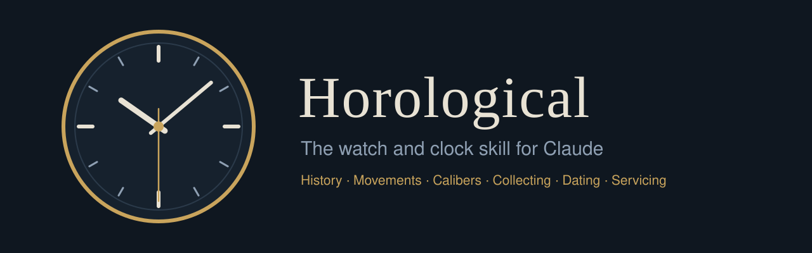

<p align="center">
  
</p>

<p align="center">
  <a href="https://github.com/z-brenner/horological/actions/workflows/ci.yml"></a>
  <a href="https://github.com/z-brenner/horological/releases/latest"></a>
  <a href="LICENSE"></a>
  
  
</p>

# Horological

**An open-source Agent Skill that makes Claude a watch and clock expert.** It works in the Claude apps, Claude Code and the Claude API.

Ask how a co-axial escapement works, who really made the first automatic chronograph, what a timegrapher reading means, how old a Seiko is from its serial, what "Swiss Made" legally guarantees, or what your collection is missing. Horological answers from a sourced knowledge base of about 37,000 words, runs the math with a tested calculator, searches for anything that changes, and says so plainly when something is uncertain.

## Quick install

**Claude Code, as a plugin:**

```
/plugin marketplace add z-brenner/horological
/plugin install horological@horological
```

**Claude Code, as a plain skill:**

```bash
git clone https://github.com/z-brenner/horological
cp -r horological/horological ~/.claude/skills/horological
```

**Claude apps:** download `horological.zip` from the [latest release](https://github.com/z-brenner/horological/releases/latest), then upload it under Skills in settings. Turn on code execution so the calculator and collection log can run.

**Claude API:** upload the `horological/` folder as a custom skill through the Skills API and use it with the code execution tool.

Then just ask a watch question. The skill loads itself when the topic comes up.

## What it does

| | |
|---|---|
| **Knows the field** | 21 reference files covering history, movements, complications, accuracy, quartz and Spring Drive, materials, standards, the industry, more than 100 brands, calibers, iconic references, collecting, dating, authentication, servicing, modding and clocks. |
| **Stays honest** | Facts are sorted into stable, slow-moving and volatile. Prices, ownership, new releases and tariffs are searched before they are stated. Disputed "firsts" are presented as disputed. |
| **Does the math** | A dependency-free calculator handles beat rates, accuracy against COSC and METAS, moonphase drift, water and magnetic units, tachymeters, pendulums, wrist fit, gold content and Seiko serial dating. |
| **Knows your collection** | An adaptive intake learns what you own, want and have sold, and how experienced you are. A local log tracks purchases, sales, services and wear, so advice fits your watch box. |
| **Researches properly** | When the files run out, a playbook points Claude to the right sources in order of reliability: movement archives, brand extracts, patents, auction results and specialist forums. |
| **Protects you** | It never authenticates a watch from photos, warns about radium lume, flags scams, and treats investment questions with facts instead of hype. |

## Try these

```
Explain column-wheel versus cam chronographs. Would I feel the difference?
My watch reads +3 s/d but only 190 degrees of amplitude. Is that a problem?
How old is my Seiko 6309 with serial 7N2xxx?
What should I check before buying a vintage Rolex 1675 from a forum seller?
Is a 135-tooth moonphase really accurate for 122 years? Show the math.
My wrist is 6.5 inches. Will a 48 mm lug-to-lug watch fit?
What is really inside a Breitling B17?
Log my collection, then tell me what I should buy next.
```

## How it is built

```
horological/                  The skill
  SKILL.md                    Operating rules, routing table, answer workflows
  references/                 21 knowledge files, loaded only when needed
  scripts/horocalc.py         Calculator
  scripts/collection.py       Local collection log and collector profile
evals/evals.json              32 behavioral test prompts with pass criteria
tests/                        Unit tests for both scripts
tools/check_skill.py          Link, frontmatter, style and eval checks
.claude-plugin/               Claude Code plugin marketplace manifest
```

The main `SKILL.md` stays short. It holds the rules and a routing table that sends each kind of question to the right reference file, so Claude reads only what a question needs.

### Reference files

| Area | File |
|---|---|
| History from water clocks to 2026, national industries, disputed firsts | `history.md` |
| Movements, escapements, oscillators, winding, lubrication, finishing | `movements.md` |
| Chronographs, GMTs, calendars, moonphases, repeaters, tourbillons | `complications.md` |
| Rate, timegrapher interpretation, COSC, METAS, brand standards | `accuracy-and-timing.md` |
| Quartz, Accutron, Spring Drive, solar, radio and GPS sync, smartwatches | `electronic.md` |
| Cases, materials, crystals, dials, lume, water resistance, bracelets | `cases-and-materials.md` |
| Swiss Made, Glashütte rule, Geneva Seal, ISO standards, hallmarks | `standards.md` |
| Groups, suppliers, distribution, industry data, tariffs | `industry.md` |
| More than 100 brands by country and tier, plus collector shorthand | `brands.md` |
| Caliber specifications, lineages, rebadges and clones | `calibers.md` |
| Iconic models and reference numbers | `references-and-models.md` |
| Buying, prices, auctions, value drivers, scams | `collecting-and-market.md` |
| Serial decoding and dating by brand | `identification-and-dating.md` |
| Fakes, frankens, redials, superclones, verification | `authentication.md` |
| Service, care and troubleshooting by symptom | `servicing-and-care.md` |
| Fit, straps, bracelet sizing, modding, building, learning watchmaking | `workbench.md` |
| Clocks, pendulums, marine chronometers, atomic time | `clocks.md` |
| Intake, collector profile and collection log | `intake-and-collection.md` |
| Myths, glossary, research methods | `myths.md`, `glossary.md`, `research-playbook.md` |

## The calculator

```bash
python3 horological/scripts/horocalc.py freq --vph 28800 --escape-teeth 15
python3 horological/scripts/horocalc.py rate --gain 52 --days 7 --standard all
python3 horological/scripts/horocalc.py moonphase --teeth 59
python3 horological/scripts/horocalc.py water --m 200
python3 horological/scripts/horocalc.py magnet --am 4800
python3 horological/scripts/horocalc.py tachy --seconds 40
python3 horological/scripts/horocalc.py telemeter --seconds 3
python3 horological/scripts/horocalc.py pendulum --period-s 2
python3 horological/scripts/horocalc.py fit --wrist-in 6.5 --lug-to-lug 48
python3 horological/scripts/horocalc.py seiko-serial 7N1234 --from-year 1976 --to-year 1988
python3 horological/scripts/horocalc.py gold --karat 18 --grams 12
python3 horological/scripts/horocalc.py ligne --lignes 11.5
```

Add `--json` before the command for machine-readable output.

## Intake and the collection log

Ask something personal, such as "what should I buy next?" or "log my collection," and the skill runs a short intake: your experience level, roughly how many watches you have, the styles you like, and what you want help with. Follow-up questions adapt. A beginner gets plain questions about brand and model. A serious collector is asked about references, calibers, condition, papers and service history. Where the app supports tappable multiple-choice questions, the skill uses them.

Everything is saved by `collection.py` to one JSON file outside the skill folder, at `~/.horological/collection.json` or `$HOROLOGICAL_HOME/collection.json`.

- Every change is recorded: purchases, sales, trades, gifts, services, notes and days worn.
- `rotation` shows which watches are neglected and the cost per wear.
- Serial numbers and prices are optional, stay in the local file, and are left out of exports unless you ask.
- Nothing is sent anywhere.

```bash
python3 horological/scripts/collection.py profile --set experience=enthusiast --set "styles=diver,GMT"
python3 horological/scripts/collection.py add --brand Seiko --model SKX007 --caliber 7S26 --style diver
python3 horological/scripts/collection.py add --status wishlist --brand Tudor --model "Black Bay 58" --priority high
python3 horological/scripts/collection.py wear seiko-skx007
python3 horological/scripts/collection.py dispose seiko-skx007 --how sold --reason upgraded
python3 horological/scripts/collection.py summary
python3 horological/scripts/collection.py export --format md --out my-collection.md
```

Persistence depends on where the skill runs. In Claude Code the file lives on your machine and persists. In the Claude apps the code sandbox can reset between conversations, so the skill offers a Markdown or JSON export to keep and re-attach, which it imports with `collection.py import`.

## FAQ

**Does it replace searching the web?** No. It tells Claude when to search and where. Prices, current catalogs, ownership and anything recent are always checked live.

**Can it tell me if my watch is real?** It can tell you what is consistent or inconsistent with a genuine example and how to get it verified. It will not certify authenticity from photos, and nobody honest can.

**How current is it?** The knowledge snapshot date is in the `SKILL.md` frontmatter. Facts that go stale are marked so Claude verifies them.

**Does it work without code execution?** Yes. The knowledge base works anywhere. The calculator and collection log need code execution.

**Is it only for collectors?** No. The intake adapts from "just curious" to working watchmaker.

**Does it cover clocks?** Yes: pendulum physics, clock escapements, striking, marine chronometers, atomic time and clock care.

## Contributing

Corrections are the most valuable contribution. Every fact change needs a source, ideally a primary one. See [CONTRIBUTING.md](CONTRIBUTING.md), or open an issue with the fact correction template.

```bash
python3 -m unittest discover -s tests
python3 tools/check_skill.py
```

Both run in CI on every push and pull request. Tagged releases attach the installable `horological.zip` automatically.

If Horological is useful to you, a star helps other watch people find it.

## Disclaimer

This project is independent and is not affiliated with, endorsed by, or sponsored by Anthropic or any watch brand, group, retailer, auction house or standards body. Brand and model names are trademarks of their owners and are used only for identification. Information is provided for education and is not financial, legal or appraisal advice. Authenticity and value can only be confirmed by physical inspection.

## License

[MIT](LICENSE)
